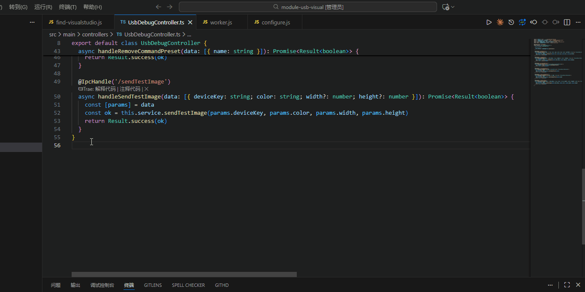
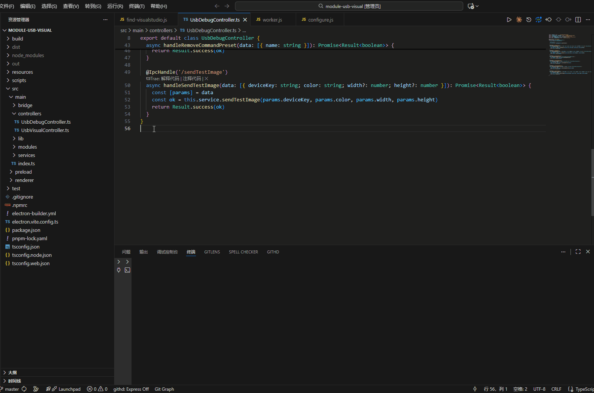

# LevelDB Viewer

A read-only VS Code viewer for ordinary LevelDB and Chromium / WebView2 IndexedDB directories, including Focus To-Do's `file__0.indexeddb.leveldb`.

[中文文档](https://github.com/g121370451/leveldb-viewer/blob/master/README-CN.md)

## Demo

### Open a LevelDB database



### Configure a workspace database path



## Features

Run **LevelDB Viewer: Open Database** and select the directory containing `CURRENT` and its referenced `MANIFEST-*`. The source application can remain open. If its files keep changing or it has a pending IndexedDB transaction, close the application and refresh the viewer.

- **Ordinary LevelDB:** browse binary-safe keys and values, formatted JSON, and a text-key tree split on `!`.
- **IndexedDB:** select a database and object store, inspect schema and indexes, and decode records into objects, arrays, dates, BigInts, maps, sets, typed arrays and other supported values.
- **Raw bytes:** inspect the first 64 KiB of a key/value without lossy UTF-8 conversion.
- **Search:** choose the current page or the entire selected store / raw record set. Entire-selection search scans decoded values in the worker and can be cancelled. Undecodable or oversized values are counted explicitly; their contents are not silently treated as searchable text.
- **Paging:** 100 records per page, with explicit next/previous controls. There is no silent 10,000-record cutoff. Ordering is the viewer's stable byte order, not an IndexedDB cursor's semantic key order. Tree mode groups the current page only.
- **Attachments:** Blob/File metadata is decoded with the record; content is read only when requested. Externalized serialized objects are loaded when their record is decoded. Keep the adjacent `*.indexeddb.blob` directory alongside the database if you copy it elsewhere.

## Source safety and large databases

The viewer never opens the source with a database engine and never writes or repairs its files. It copies database files (excluding `LOCK`), checks file metadata before/after copying, validates checksums, and builds its own disposable query index. A LevelDB engine is used only for that private index.

The first open copies the database and scans its physical records. Refresh reuses unchanged immutable `.ldb` / `.sst` files using hard links **between viewer-owned snapshots**, never links to source files. Mutable logs and manifests are copied again. The query index is rebuilt on refresh to reconcile versions and deletions. Consequently, refresh reduces copying but still scans the database. This is not an instant-open or zero-copy implementation.

Browsing and searching reuse the current snapshot. Refresh builds a new snapshot/index and switches only after success. Cancellation or a failed build leaves the previous view available. Copying detects some source changes and retries at most twice; this is a best-effort copy, not an atomic database snapshot or a guarantee of the latest committed application state.

Attachments are read on demand from the source's adjacent blob directory. They can disappear or change after the database snapshot. The viewer reports missing/changed files and does not substitute empty objects.

The viewer keeps one active snapshot/index per panel, plus a candidate during refresh. Closing the panel releases its cache. Abandoned sessions older than 24 hours are reclaimed on a later open only when their owning process is no longer alive. An approximate per-panel disk budget is checked before copying and between index batches; compression, pending native writes, and a single batch can temporarily overshoot it.

When a workspace is open, the extension checks whether the workspace is an Electron project. The project is considered Electron-based when its `package.json` has `electron` in `dependencies` or `devDependencies`.

Supported comparator names are `leveldb.BytewiseComparator` and `idb_cmp1`. The reader handles LevelDB manifests, live tables, WAL write batches, sequence numbers, tombstones, fragmented logs, and uncompressed/Snappy table blocks. It does not rewrite comparator names or scan obsolete files as if they were live records.

IndexedDB support includes metadata, primary keys, schema, common Blink envelopes, Snappy-wrapped values, externalized values, Blob/File references, and V8 wire versions 13–16. Older envelopes are attempted through the host Node decoder. Unknown serialization versions, browser-specific host objects, unsupported compression and custom comparators are reported explicitly; raw bytes remain available when the database itself can be read. Resizable buffers are displayed using their current contents. Application-specific encryption or serialization inside a field is not automatically decoded.

Pending IndexedDB scope records are conservatively rejected rather than exposing partially committed data. This is a viewer, not a recovery tool. Unfinished WAL tail records are ignored, as they do not form complete write batches. Table blocks and individual WAL records are limited to 256 MiB.

## Settings

## Settings and AppData quick open

| Setting | Default | Meaning |
| --- | --- | --- |
| `leveldbViewer.databasePath` | empty | Absolute path for this workspace; takes precedence over detection. |
| `leveldbViewer.maxSnapshotGB` | 10 | Maximum source database size in GiB. |
| `leveldbViewer.maxCacheGB` | 20 | Approximate per-viewer disk cache budget in GiB. |
| `leveldbViewer.maxValueMB` | 32 | Maximum individual value / attachment to decode in MiB. |

When no path is configured, an Electron project's `package.json` name is used to look for `%APPDATA%/<name>/db`. Use manual selection or `databasePath` for WebView2 / Store apps.

Project-only settings can be stored in:

```sh
npm ci
npm test
npm run test:ui
npm run package
```

## Commands

- `LevelDB Viewer: Open Database`: manually select and open a LevelDB directory.
- `LevelDB Viewer: Open Detected AppData Database`: open the detected/configured database from the status bar logic.
- `LevelDB Viewer: Configure Database Path`: select a LevelDB directory and save it to the current workspace settings.
- `LevelDB Viewer: Open Settings`: open the VS Code Settings UI filtered to this extension.
